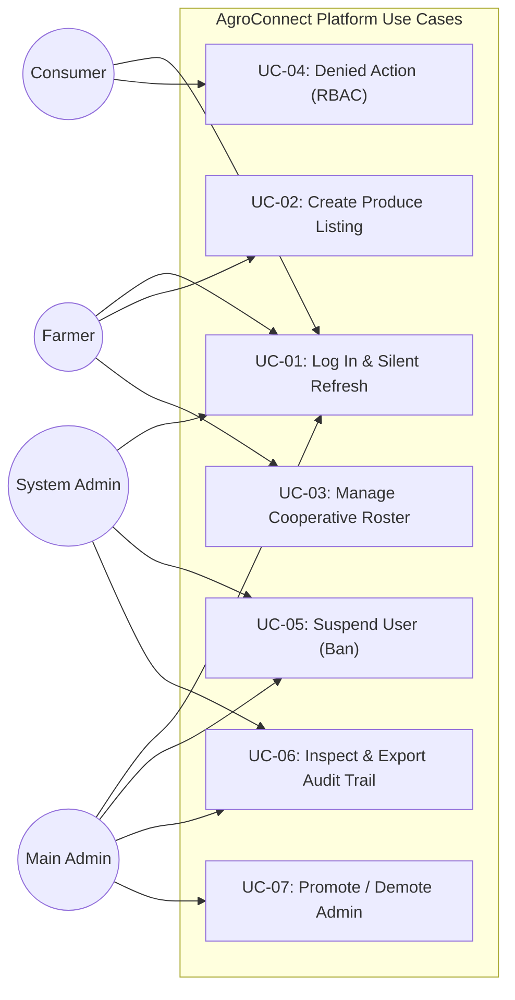
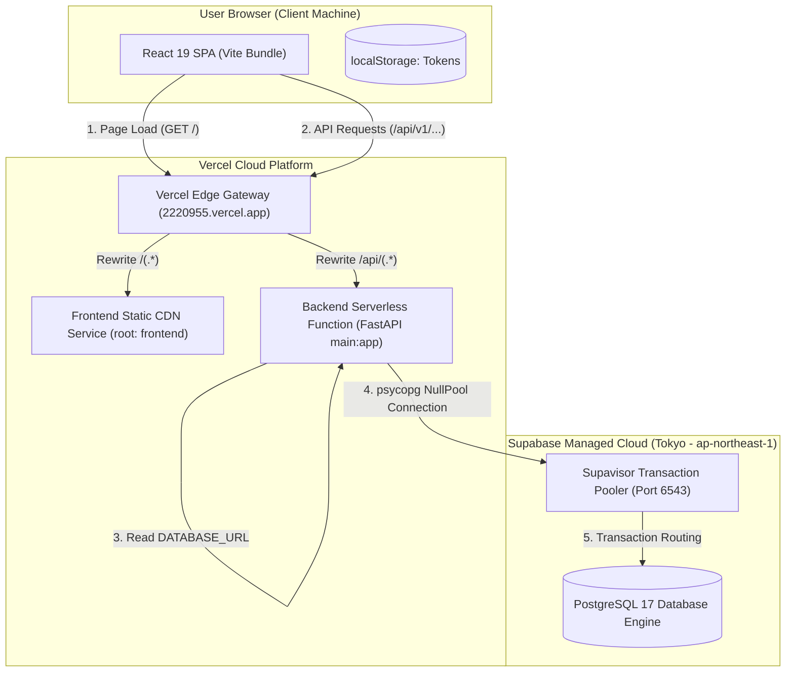
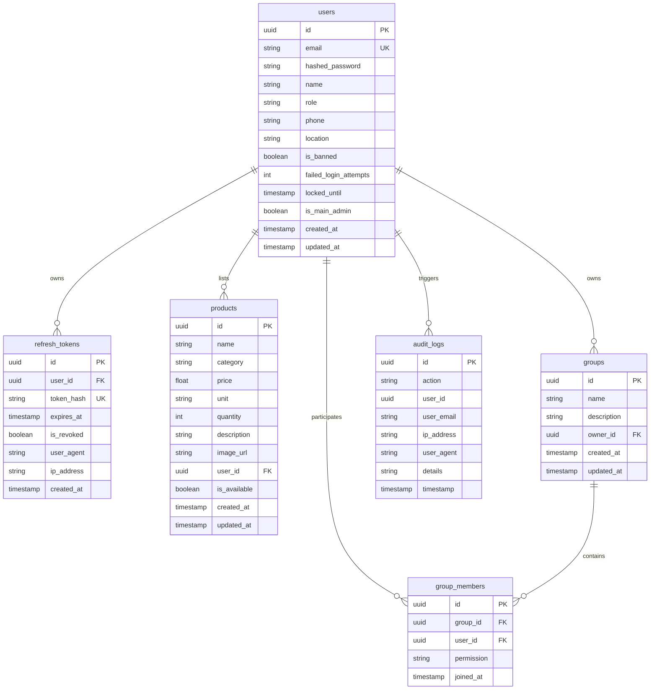
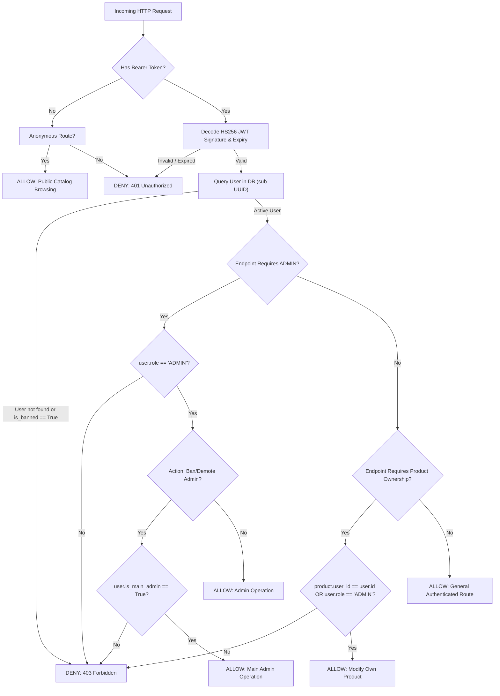
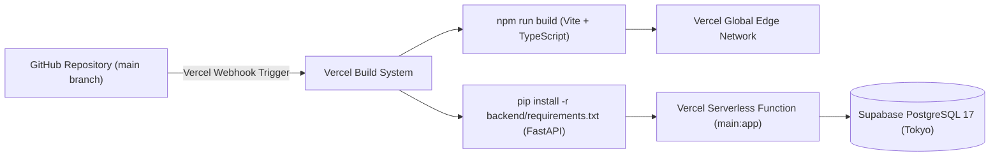

# Independent University, Bangladesh
## Department of Computer Science & Engineering
### CSE309: Web Application & Internet

---

# Final Project Submission Report
**Project Title:** AgroConnect — Farmer-to-Consumer Agricultural Marketplace  
**Semester:** Autumn 2026  
**Date of Submission:** 27-11-2026  

**Submitted by:**  
* **Name:** Zahidul Hasan Sourov  
* **Student ID:** 2220955  
* **Section:** 06  

**Submitted To:**  
* **Instructor:** Sayef Reyadh  
* **Designation:** Adjunct Lecturer, Department of Computer Science & Engineering  
* **Institution:** Independent University, Bangladesh  

---

**Project Live Links:**
* **Vercel Production Deployment:** [https://2220955.vercel.app](https://2220955.vercel.app)
* **GitHub Repository:** [https://github.com/zahidulhasan12/Farmer-to-consumer-agricultural-marketplace](https://github.com/zahidulhasan12/Farmer-to-consumer-agricultural-marketplace)
* **API Documentation (Swagger UI):** [https://2220955.vercel.app/api/docs](https://2220955.vercel.app/api/docs)

---

## Table of Contents
* [1. Executive Summary](#1-executive-summary)
  * [1.1 Project Overview](#11-project-overview)
  * [1.2 What Was Built Since the Mid Assessment](#12-what-was-built-since-the-mid-assessment)
  * [1.3 Live Links](#13-live-links)
* [Part A. Product Requirements (PRD)](#part-a-product-requirements-prd)
  * [A1. Problem Statement](#a1-problem-statement)
  * [A2. Users and Roles](#a2-users-and-roles)
  * [A3. Goals and Success Measures](#a3-goals-and-success-measures)
  * [A4. Scope and Non-Goals](#a4-scope-and-non-goals)
  * [A5. User Stories](#a5-user-stories)
* [Part B. Software Requirements (SRS)](#part-b-software-requirements-srs)
  * [B1. Introduction](#b1-introduction)
  * [B2. Functional Requirements](#b2-functional-requirements)
  * [B3. Non-Functional Requirements](#b3-non-functional-requirements)
  * [B4. Roles and Permission Matrix](#b4-roles-and-permission-matrix)
  * [B5. Use Cases](#b5-use-cases)
  * [B6. Acceptance Criteria](#b6-acceptance-criteria)
  * [B7. Traceability Matrix](#b7-traceability-matrix)
* [Part C. Technical Design (TDD)](#part-c-technical-design-tdd)
  * [C1. Technology Stack](#c1-technology-stack)
  * [C2. System Architecture](#c2-system-architecture)
  * [C3. Backend and Frontend Structure](#c3-backend-and-frontend-structure)
  * [C4. Data Model](#c4-data-model)
  * [C5. API Design](#c5-api-design)
  * [C6. JWT Authentication Design](#c6-jwt-authentication-design)
  * [C7. RBAC Design](#c7-rbac-design)
  * [C8. Admin Dashboard Design](#c8-admin-dashboard-design)
  * [C9. Security Design and Threats](#c9-security-design-and-threats)
  * [C10. Deployment on Vercel](#c10-deployment-on-vercel)
  * [C11. Testing Strategy and Results](#c11-testing-strategy-and-results)
* [Part D. Evidence: Screenshots of the Running Application](#part-d-evidence-screenshots-of-the-running-application)
  * [D1. User Side](#d1-user-side)
  * [D2. Security Behaviour](#d2-security-behaviour)
  * [D3. Admin Dashboard](#d3-admin-dashboard)
  * [D4. Deployment](#d4-deployment)
  * [D5. Tests](#d5-tests)
* [Part E. Project Management and Conclusion](#part-e-project-management-and-conclusion)
  * [E1. How to Run and Test](#e1-how-to-run-and-test)
  * [E2. GitHub Work & PR History](#e2-github-work--pr-history)
  * [E3. Limitations](#e3-limitations)
  * [E4. Future Work](#e4-future-work)
  * [E5. Sources, Libraries and Tools](#e5-sources-libraries-and-tools)
* [Appendix. Test Accounts and Video Demo](#appendix-test-accounts-and-video-demo)

---

## 1. Executive Summary

### 1.1 Project Overview
**AgroConnect** is an enterprise-grade, farmer-to-consumer direct agricultural e-commerce platform designed to eliminate exploitative intermediaries (middlemen) from the agricultural supply chain in Bangladesh. The system empowers local agricultural producers to list harvested crops, manage real-time inventory, and form collective farmer cooperatives, while providing urban consumers with fresh produce at fair farm-gate prices. The platform incorporates a two-tier governance framework comprising a supreme **Main Administrator** and moderation-focused **System Administrators** to maintain marketplace integrity and compliance.

**Full Stack Technology in One Line:**  
React 19 with TypeScript, Vite 8, Ant Design 5, FastAPI 0.110 (Python 3.10), SQLModel ORM, Argon2 & JWT security, connected to persistent Supabase PostgreSQL 17 via Psycopg 3, and deployed serverless on Vercel.

### 1.2 What Was Built Since the Mid Assessment
Since the midterm assessment, the system has evolved from a basic CRUD prototype into a production-hardened platform:
* **JWT Authentication with Refresh and Logout:** Built stateful, dual-token authentication utilizing short-lived 30-minute HMAC-SHA256 access tokens and 14-day cryptographic refresh tokens stored with SHA-256 hashes in PostgreSQL, complete with silent client-side token rotation, token replay attack detection, and immediate logout revocation.
* **Two-Tier Role-Based Access Control (RBAC):** Implemented a strict 4-role hierarchy (Main Admin, System Admin, Farmer, Consumer) with ownership enforcement, self-protection rules, administrative immunity, and cooperative group permissions (`ADMIN`, `MEMBER`, `VIEW_ONLY`).
* **Admin Dashboard & Platform Governance:** Constructed a full-featured administrative control suite providing real-time KPI metrics, searchable user management with role toggles, hierarchical suspension/reactivation, tamper-resistant audit logs, and filtered CSV forensic exports.
* **Audit Logging, Brute-Force Defense & Production Cloud Deployment:** Added a 5-strike brute-force account lockout mechanism (15-minute freeze), automatic session purging upon user suspension, integrated persistent Supabase PostgreSQL connection pooling (`NullPool` + `prepare_threshold=None`), and deployed the full-stack monorepo to Vercel.

### 1.3 Live Links

#### Table 1: Links
| Resource | URL | Description |
| :--- | :--- | :--- |
| **GitHub Repository** | `https://github.com/zahidulhasan12/Farmer-to-consumer-agricultural-marketplace` | Complete source code, automated test suite, issue tracker, and pull requests. |
| **Vercel Frontend** | `https://2220955.vercel.app` | Production single-page React application hosted on Vercel Edge CDN. |
| **Backend API** | `https://2220955.vercel.app/api/v1` | Production FastAPI serverless service connected to Supabase PostgreSQL. |
| **API Documentation** | `https://2220955.vercel.app/api/docs` | Interactive OpenAPI / Swagger UI testing suite. |
| **Video Demo** | `   ` | 5–8 minute walkthrough illustrating authentication, RBAC, admin moderation, and live produce sales. |

---

## Part A. Product Requirements (PRD)

### A1. Problem Statement
In developing agrarian economies like Bangladesh, smallholder farmers face severe market fragmentation. Due to lack of direct access to retail consumers, farmers are forced to sell their perishable yields to local syndicates, commission agents, and middlemen (*farias* and *arotdars*) at prices that barely cover cultivation costs. Concurrently, urban consumers in metropolitan centers like Dhaka and Chittagong pay inflated retail prices due to multiple speculative markups and transport inefficiencies. 

Existing solutions consist of fragmented social media groups or general-purpose classified websites lacking dedicated agricultural inventory controls, cooperative bargaining capabilities, or verified role governance. Small farmers lack the technical literacy to operate complex software and have no platform to collectively pool logistics. AgroConnect addresses this crisis by providing a purpose-built, accessible agricultural marketplace with cooperative collective formation, transparent pricing, and robust administrative oversight.

### A2. Users and Roles

#### Table 2: Users and Roles
| Role | Who They Are | Main Tasks | What They Must Never Be Able To Do |
| :--- | :--- | :--- | :--- |
| **Visitor (Guest)** | Unauthenticated public visitor exploring the marketplace. | Browse produce, search by name/category, view farm origins, inspect public cooperative pages. | Cannot create products, join cooperatives, contact farmers, or access any administrative routes. |
| **Consumer (`CONSUMER`)** | Retail or household buyer purchasing fresh agricultural goods. | Browse catalog, search produce, view farmer credentials, join cooperatives as view-only members. | Cannot list produce for sale, modify farmer products, ban users, or access the admin dashboard. |
| **Farmer (`FARMER`)** | Verified agricultural producer or grower. | Create crop listings, update stock levels and pricing, create farmer cooperatives, add cooperative members. | Cannot modify or delete other farmers' produce listings; cannot access administrative dashboards or promote users. |
| **System Admin (`ADMIN`)** | Marketplace moderator overseeing daily trading operations. | View platform KPI statistics, inspect security audit trails, suspend/reactivate abusive farmers and consumers, manage all products. | **Cannot ban other Administrators; cannot ban the Main Admin; cannot promote or demote administrator roles; cannot demote themselves.** |
| **Main Admin (`ADMIN`, `is_main_admin=True`)** | Platform owner and supreme compliance authority. | Promote/demote administrators, ban or unban any account (including System Admins), purge sessions, export forensic logs. | **Cannot ban themselves; cannot demote their own account.** The Main Admin is completely immune from external bans. |

### A3. Goals and Success Measures

#### Table 3: Goal and Measure
| Goal ID | Objective | Measurable Success Metric | Target / Standard |
| :---: | :--- | :--- | :--- |
| **GM-01** | **Direct Producer Empowerment** | Registered farmers listing crops directly. | At least 8 distinct agricultural products listed across grains, vegetables, and dairy. |
| **GM-02** | **Cooperative Collective Formation** | Shared logistics and cold storage collective capability. | At least 1 active cooperative collective created with multi-member role permissions. |
| **GM-03** | **Access Token Security** | Strict limitation on compromised token longevity. | Access tokens expire in strictly **30 minutes**; rejected with `401 Unauthorized` thereafter. |
| **GM-04** | **Serverless Session Invalidation** | Immediate revocation of compromised refresh sessions. | Token revocation persists in database; replay attack revokes 100% of user sessions. |
| **GM-05** | **Brute-Force Attack Mitigation** | Prevention of credential-stuffing attacks. | Exactly **5 consecutive failed login attempts** triggers a **15-minute lockout** (`423 Locked`). |
| **GM-06** | **High Performance & Zero Data Loss** | Rapid response and persistence across serverless restarts. | Serverless API response time `< 300ms`; 100% data persistence on Supabase PostgreSQL. |

### A4. Scope and Non-Goals
* **In Scope:**
  * Stateful dual-token JWT authentication (access token, refresh token, rotation, server-side revocation).
  * Two-tier administrative governance (Main Admin supremacy vs. System Admin moderation).
  * Product catalog management (full CRUD with ownership verification, categorization, and stock counts).
  * Cooperative collectives (`Group`, `GroupMember`) with granular permissions (`ADMIN`, `MEMBER`, `VIEW_ONLY`).
  * Tamper-resistant security audit trail tracking logins, failed logins, lockouts, signups, bans, and role changes.
  * Filtered CSV audit trail exports and real-time dashboard analytics.
  * Serverless production deployment on Vercel backed by Supabase PostgreSQL.
* **Out of Scope (Deferred to Future Work):**
  * Live payment gateway integrations (bKash/Nagad/SSLCommerz merchant escrow).
  * Real-time GPS delivery fleet tracking.
  * Native iOS and Android mobile compilation (handled via responsive web layout).
* **Assumptions and Constraints:**
  * Users access the platform via modern desktop or mobile evergreen web browsers (Chrome, Edge, Safari, Firefox).
  * Database operations must support Vercel serverless functions without connection pool exhaustion (solved via Supabase transaction pooler on port 6543).

### A5. User Stories

#### Table 4: User Stories
| ID | As a (Role) | I Want (Action) | So That (Benefit) |
| :---: | :--- | :--- | :--- |
| **US-01** | Visitor | To register as a Farmer or Consumer with validated credentials | I can access role-specific marketplace functionality. |
| **US-02** | User | To log into my account using my email and password | I can securely authenticate and obtain a 30-minute JWT session. |
| **US-03** | User | To have my session silently refreshed in the background | I am not interrupted or abruptly logged out while browsing the catalog. |
| **US-04** | User | To log out of my account from any device | My refresh token is immediately invalidated on the server. |
| **US-05** | Farmer | To list a harvested agricultural product with price and quantity | Urban consumers can discover and order my harvest directly. |
| **US-06** | Farmer | To edit or delete only my own listed products | Other producers cannot tamper with or manipulate my inventory. |
| **US-07** | Farmer | To create a farmer cooperative collective | I can collaborate with neighboring farmers to share bulk logistics and storage. |
| **US-08** | Consumer | To browse all available produce without logging in | I can inspect pricing, origin, and freshness before registering. |
| **US-09** | System Admin | To view aggregated marketplace KPIs (users, stock, inventory value) | I can monitor real-time economic health and market supply. |
| **US-10** | System Admin | To suspend fraudulent consumers or abusive farmers | I can safeguard buyers from scam listings and preserve platform trust. |
| **US-11** | Main Admin | To promote users to Administrator or demote administrators | I have exclusive authority to assign executive governance privileges. |
| **US-12** | Main Admin | To inspect and export the system security audit trail to CSV | I can perform compliance audits, review IP addresses, and investigate security breaches. |

---

## Part B. Software Requirements (SRS)

### B1. Introduction
This Software Requirements Specification (SRS) details the complete functional and non-functional requirements for AgroConnect. Intended readers include course examiners, software engineers, system administrators, and security auditors.

#### Table 4.1: Definitions and Acronyms
| Term | Definition |
| :--- | :--- |
| **JWT** | JSON Web Token (RFC 7519): A compact, URL-safe means of representing claims between two parties. |
| **Access Token** | A short-lived, digitally signed bearer token passed in HTTP `Authorization` headers to authorize API requests. |
| **Refresh Token** | A high-entropy, long-lived token stored hashed in the database used to obtain fresh access tokens. |
| **RBAC** | Role-Based Access Control: An access regulation mechanism based on user roles and explicit permission grants. |
| **Argon2** | Memory-hard cryptographic password hashing algorithm, winner of the Password Hashing Competition (PHC). |
| **Audit Log** | An append-only, immutable record capturing critical security and governance operations for forensic auditability. |

**References:** RFC 7519 (JSON Web Token), RFC 6749 (OAuth 2.0 Authorization Framework), OWASP Application Security Verification Standard (ASVS 4.0), FastAPI Documentation, Supabase Database Guide.

### B2. Functional Requirements

#### Table 5: Authentication Functional Requirements (FR-AUTH)
| ID | Requirement Statement | Status |
| :---: | :--- | :---: |
| **FR-AUTH-01** | The system shall provide a registration endpoint (`POST /api/v1/auth/signup`) accepting email, password, full name, role (`FARMER`/`CONSUMER`), phone, and location. | Implemented |
| **FR-AUTH-02** | The system shall reject registration requests with duplicate email addresses with HTTP `409 Conflict`. | Implemented |
| **FR-AUTH-03** | The system shall salt and hash all passwords using the Argon2 algorithm via `pwdlib[argon2]`; plaintext passwords shall never be stored. | Implemented |
| **FR-AUTH-04** | The system shall issue a signed HS256 JWT access token upon successful authentication containing claims `sub`, `email`, `name`, `role`, `iat`, and `exp`. | Implemented |
| **FR-AUTH-05** | The access token lifetime shall be strictly configured to 30 minutes. | Implemented |
| **FR-AUTH-06** | The system shall issue a 48-byte URL-safe cryptographic refresh token with a 14-day validity window upon login/signup. | Implemented |
| **FR-AUTH-07** | The system shall store refresh tokens in the database exclusively as SHA-256 hashes (`hashlib.sha256`). | Implemented |
| **FR-AUTH-08** | The system shall support silent token refresh via `POST /api/v1/auth/refresh`; every refresh operation shall revoke the used token and issue a new token pair (Token Rotation). | Implemented |
| **FR-AUTH-09** | The system shall detect token replay attacks: if an already-revoked refresh token is received, all active sessions for that user shall be immediately terminated. | Implemented |
| **FR-AUTH-10** | The system shall track failed login attempts; exactly 5 consecutive failures shall lock the account for 15 minutes (`423 Locked`). | Implemented |
| **FR-AUTH-11** | The system shall provide a logout endpoint (`POST /api/v1/auth/logout`) that immediately marks the active refresh token as revoked (`is_revoked = True`). | Implemented |
| **FR-AUTH-12** | The system shall provide a password change endpoint (`PUT /api/v1/auth/change-password`) requiring old password verification and revoking all active sessions upon success. | Implemented |

#### Table 6: Role-Based Access Control Requirements (FR-RBAC)
| ID | Requirement Statement | Status |
| :---: | :--- | :---: |
| **FR-RBAC-01** | The system shall enforce role validation server-side on every protected endpoint using FastAPI dependencies (`require_admin`, `CurrentUserDep`). | Implemented |
| **FR-RBAC-02** | The system shall prohibit users with role `CONSUMER` from creating agricultural product listings (`403 Forbidden`). | Implemented |
| **FR-RBAC-03** | The system shall restrict product update and delete operations strictly to the farmer who listed the product or a user with role `ADMIN`. | Implemented |
| **FR-RBAC-04** | The system shall provide ownership-filtered listing (`GET /api/v1/products?mine=true`) returning exclusively products owned by the authenticated user. | Implemented |
| **FR-RBAC-05** | The system shall reject suspended users (`is_banned = True`) on every protected request immediately with HTTP `403 Forbidden`. | Implemented |
| **FR-RBAC-06** | The system shall support cooperative collective creation (`POST /api/v1/groups`) restricted to Farmers and Admins. | Implemented |
| **FR-RBAC-07** | The system shall support cooperative member permissions (`ADMIN`, `MEMBER`, `VIEW_ONLY`), restricting member addition and collective deletion to cooperative owners. | Implemented |

#### Table 7: Administration & Governance Requirements (FR-ADM)
| ID | Requirement Statement | Status |
| :---: | :--- | :---: |
| **FR-ADM-01** | The system shall provide an admin dashboard statistics endpoint (`GET /api/v1/admin/stats`) aggregating users, roles, products, inventory value, and groups. | Implemented |
| **FR-ADM-02** | The system shall provide a searchable, paginated user management endpoint (`GET /api/v1/admin/users`) displaying product counts per user. | Implemented |
| **FR-ADM-03** | The system shall provide a user suspension endpoint (`PATCH /api/v1/admin/users/{id}/ban`) setting `is_banned` and revoking all active refresh tokens. | Implemented |
| **FR-ADM-04** | The system shall prevent administrators from banning their own account (`400 Bad Request`). | Implemented |
| **FR-ADM-05** | The system shall prevent any user from banning the Main Administrator (`400 Bad Request`); the Main Admin shall be completely immune from suspension. | Implemented |
| **FR-ADM-06** | The system shall restrict System Administrators from banning other Administrators (`403 Forbidden`); only the Main Admin may suspend an Administrator. | Implemented |
| **FR-ADM-07** | The system shall restrict user promotion to `ADMIN` and demotion of `ADMIN` strictly to users with `is_main_admin = True`. | Implemented |
| **FR-ADM-08** | The system shall record tamper-resistant security audit logs (`audit_logs`) for all logins, failed attempts, lockouts, signups, bans, and role modifications. | Implemented |
| **FR-ADM-09** | The system shall provide filtered CSV exports of the audit log (`GET /api/v1/admin/audit-logs/export-csv`) respecting search and action filters. | Implemented |

#### Table 8: Domain Agricultural Product Requirements (FR-DOMAIN)
| ID | Requirement Statement | Status |
| :---: | :--- | :---: |
| **FR-DOMAIN-01** | The system shall support product creation with name, category (Vegetables, Fruits, Grains, Dairy, Poultry, Other), price, unit (kg, liter, dozen), quantity, and description. | Implemented |
| **FR-DOMAIN-02** | The system shall automatically populate farmer name, location, and phone number from the farmer's profile if omitted during product creation. | Implemented |
| **FR-DOMAIN-03** | The system shall provide public product catalog browsing with multi-category filtering, text search, and pagination. | Implemented |
| **FR-DOMAIN-04** | The system shall automatically seed 8 default agricultural marketplace items and 6 platform accounts upon first startup if the database is empty. | Implemented |

### B3. Non-Functional Requirements

#### Table 9: Non-Functional Requirements
| Category | Requirement ID | Specification | Verification Method |
| :--- | :---: | :--- | :--- |
| **Security** | **NFR-SEC-01** | All secrets (`JWT_SECRET_KEY`, `DATABASE_URL`) must be loaded from environment variables; zero hardcoded credentials in git. | Automated static check & `.gitignore` review. |
| **Security** | **NFR-SEC-02** | Generic error messages returned on authentication failure (`Invalid email or password`) to prevent account enumeration. | Automated test assertion (`test_login_invalid_password`). |
| **Performance**| **NFR-PERF-01**| Database queries must return in under 300ms using indexed columns (`email`, `user_id`, `token_hash`). | API performance benchmark on Vercel deployment. |
| **Performance**| **NFR-PERF-02**| Default pagination limit fixed to 50 items (max 100) to protect database memory under high load. | Pydantic query constraint validation. |
| **Usability**  | **NFR-USE-01** | Single-page application must be fully responsive across mobile, tablet, and desktop breakpoints with green agrarian theme. | Ant Design grid and component rendering audit. |
| **Reliability**| **NFR-REL-01** | Data must persist permanently across Vercel serverless function cold-starts by utilizing external Supabase PostgreSQL storage. | Serverless container sleep & wake-up persistence test. |
| **Maintainability**| **NFR-MNT-01**| 100% centralized RBAC dependency injection and 100% automated test suite passing. | All 37 pytest tests passing in under 3 seconds. |

### B4. Roles and Permission Matrix

#### Table 10: Endpoint Groups by Roles
| Endpoint Group | Visitor | Consumer | Farmer | System Admin | Main Admin |
| :--- | :---: | :---: | :---: | :---: | :---: |
| **Auth (Signup, Login, Refresh)** | Yes | Yes | Yes | Yes | Yes |
| **Public Products (Browse, Search, Filter)**| Yes | Yes | Yes | Yes | Yes |
| **Product Create (List Produce)** | No | No | Yes | Yes | Yes |
| **Product Update / Delete** | No | No | Own | Yes | Yes |
| **Cooperative Create** | No | No | Yes | Yes | Yes |
| **Cooperative Manage Members** | No | No | Own | Own | Yes |
| **Admin Stats & User Search** | No | No | No | Yes | Yes |
| **Moderate Farmers / Consumers (Ban/Unban)**| No | No | No | Yes | Yes |
| **Moderate Admins (Ban/Unban System Admin)**| No | No | No | No | Yes |
| **Role Change (Promote/Demote Admins)** | No | No | No | No | Yes |
| **Audit Logs & CSV Export** | No | No | No | Yes | Yes |

#### Table 11: Group Permissions Matrix
| Action | `VIEW_ONLY` | `MEMBER` | `ADMIN` | Cooperative Owner |
| :--- | :---: | :---: | :---: | :---: |
| **View Collective Roster** | Yes | Yes | Yes | Yes |
| **Share Collective Transport / Storage** | No | Yes | Yes | Yes |
| **Add New Farmer Members** | No | No | Yes | Yes |
| **Change Member Permission Levels** | No | No | No | Yes |
| **Remove Cooperative Members** | No | No | No | Yes |
| **Disband / Delete Cooperative** | No | No | No | Yes |

#### Table 12: Admin Rules Matrix
| Rule Description | System Admin | Main Admin | Enforcement Mechanism |
| :--- | :---: | :---: | :--- |
| **Can Ban Farmers and Consumers** | Yes | Yes | `backend/app/admin/service.py` Line 100 |
| **Can Ban Another Administrator** | **No** (403 Forbidden) | **Yes** | `backend/app/admin/service.py` Line 101 |
| **Can Ban the Main Administrator** | **No** (400 Bad Request)| **No** (Immune) | `backend/app/admin/service.py` Line 96 |
| **Can Ban Their Own Account** | **No** (400 Bad Request)| **No** (400 Bad Request) | `backend/app/admin/service.py` Line 88 |
| **Can Promote Users to Admin** | **No** (403 Forbidden) | **Yes** | `backend/app/admin/service.py` Line 137 |
| **Can Demote Admins to Farmer/Consumer**| **No** (403 Forbidden) | **Yes** | `backend/app/admin/service.py` Line 137 |
| **Can Demote Themselves** | **No** (400 Bad Request)| **No** (400 Bad Request) | `backend/app/admin/service.py` Line 129 |

### B5. Use Cases



#### Table 13: Detailed Use Case Descriptions
| Use Case | Actor | Preconditions | Main Flow | Alternative / Error Flows | Postconditions |
| :--- | :--- | :--- | :--- | :--- | :--- |
| **UC-01: Log In & Silent Refresh** | Any Registered User | Account created and active. | 1. Enter email and password.<br>2. Backend verifies Argon2 hash.<br>3. Receives access token (30m) & refresh token (14d).<br>4. Interceptor silently refreshes upon expiry. | • Wrong password &rarr; `401 Unauthorized`.<br>• 5 failed tries &rarr; `423 Locked`.<br>• User banned &rarr; `403 Forbidden`. | User authenticated; state saved in React context. |
| **UC-02: Create Produce Listing** | Farmer | Authenticated with `role="FARMER"`. | 1. Click "Add Product".<br>2. Fill crop details, stock, unit price.<br>3. Submit form &rarr; `POST /api/v1/products`. | • `role="CONSUMER"` &rarr; `403 Forbidden`.<br>• Invalid fields &rarr; `422 Validation Error`. | Produce stored in PostgreSQL with farmer ownership. |
| **UC-03: Manage Cooperative Roster** | Farmer (Owner) | Owns active cooperative collective. | 1. Navigate to Cooperatives tab.<br>2. Enter member email and permission level.<br>3. Submit member addition &rarr; `POST /groups/{id}/members`. | • Non-owner tries &rarr; `403 Forbidden`.<br>• User already in group &rarr; `409 Conflict`. | Member added with assigned permission level. |
| **UC-04: Denied Action by RBAC** | Consumer | Authenticated with `role="CONSUMER"`. | 1. Consumer attempts to call `POST /api/v1/products` via API client. | • Backend intercepts role &rarr; returns `403 Forbidden` (`Only registered farmers can list produce`). | Request blocked; zero database state modification. |
| **UC-05: Suspend Malicious User** | Main Admin or System Admin | Authenticated as Administrator. | 1. Open Admin Dashboard.<br>2. Click "Suspend" next to target account.<br>3. Backend verifies hierarchy and updates `is_banned=True`. | • System Admin targets Admin &rarr; `403 Forbidden`.<br>• Target is Main Admin &rarr; `400 Bad Request`. | User suspended; all active sessions immediately revoked. |
| **UC-06: Inspect & Export Audit Trail** | Administrator | Authenticated as Administrator. | 1. Click Security & Audit Trail tab.<br>2. Filter by action (e.g. `LOGIN`, `USER_BANNED`).<br>3. Click "Export CSV". | • Token expired &rarr; silent refresh or redirect.<br>• Non-admin &rarr; `403 Forbidden`. | Tamper-resistant forensic CSV downloaded to disk. |

### B6. Acceptance Criteria

#### Table 14: Given-When-Then Acceptance Criteria
| Requirement ID | Scenario | Given (Initial Context) | When (Action Triggered) | Then (Expected Outcome) |
| :---: | :--- | :--- | :--- | :--- |
| **AC-AUTH-01** | Expired Access Token | User has an access token older than 30 minutes. | User issues API request to protected endpoint. | Server returns `401 Unauthorized`; client calls `/refresh` transparently. |
| **AC-AUTH-02** | Tampered JWT Signature | User modifies JWT payload or signature string. | Tampered token sent in `Authorization` header. | Server rejects request immediately with `401 Unauthorized` (`Invalid access token`). |
| **AC-AUTH-03** | Brute-Force Lockout | Registered user account exists. | Attacker submits 5 consecutive incorrect passwords. | Server returns `423 Locked`; account locked for exactly 15 minutes. |
| **AC-RBAC-01** | Consumer Product Creation Denial | Logged-in user has role `CONSUMER`. | User submits product creation request. | Server rejects with `403 Forbidden`; no product created. |
| **AC-RBAC-02** | Product Modification Isolation | Farmer A owns Product #1; Farmer B is authenticated. | Farmer B sends `PUT /api/v1/products/1`. | Server rejects with `403 Forbidden`; only owner or admin can edit. |
| **AC-ADM-01** | Banned User Rejection | User account is marked `is_banned = True`. | User makes any authenticated API request. | Server returns `403 Forbidden`; all active refresh tokens revoked. |
| **AC-ADM-02** | Main Admin Ban Immunity | Main Admin account exists (`is_main_admin = True`). | System Admin sends ban request targeting Main Admin. | Server rejects with `400 Bad Request`; Main Admin remains active. |
| **AC-ADM-03** | System Admin Protection | Two System Admins exist (Admin A and Admin B). | Admin A attempts to ban Admin B. | Server rejects with `403 Forbidden` (`Only Main Admin can moderate Admins`). |

### B7. Traceability Matrix

#### Table 15: Requirements Traceability Matrix
| Requirement ID | Description | Implementing File & Endpoint | Automated Test Name | Evidence Screenshot ID |
| :---: | :--- | :--- | :--- | :---: |
| **FR-AUTH-01** | User Registration | `backend/app/auth/router.py` (`POST /signup`) | `test_signup_farmer_success` | **S1** |
| **FR-AUTH-03** | Argon2 Password Hashing | `backend/app/auth/service.py` (`hash_password`) | `test_signup_farmer_success` | **S1** |
| **FR-AUTH-04** | HS256 JWT Generation | `backend/app/auth/service.py` (`create_access_token`) | `test_login_success` | **S8** |
| **FR-AUTH-08** | Silent Refresh & Rotation | `backend/app/auth/service.py` (`refresh`) | `test_refresh_token_rotation` | **S8** |
| **FR-AUTH-10** | 5-Strike Account Lockout | `backend/app/auth/service.py` (`login`) | `test_brute_force_account_lockout` | **S16** |
| **FR-AUTH-11** | Logout & Session Revoke | `backend/app/auth/router.py` (`POST /logout`) | `test_logout_revocation` | **S4** |
| **FR-RBAC-02** | Consumer Listing Denial | `backend/app/products/router.py` (`POST /products`) | `test_consumer_cannot_create_product` | **S6** |
| **FR-RBAC-03** | Product Ownership Check | `backend/app/products/router.py` (`PUT /products/{id}`) | `test_other_farmer_cannot_modify_or_delete_product` | **S2** |
| **FR-RBAC-06** | Cooperative Creation | `backend/app/groups/router.py` (`POST /groups`) | `test_farmer_can_create_cooperative` | **S5** |
| **FR-ADM-01** | Overview KPI Statistics | `backend/app/admin/router.py` (`GET /stats`) | `test_admin_can_access_stats` | **S10** |
| **FR-ADM-03** | User Suspension & Purge | `backend/app/admin/service.py` (`toggle_user_ban`) | `test_main_admin_can_ban_and_unban_system_admin` | **S13** |
| **FR-ADM-05** | Main Admin Immunity | `backend/app/admin/service.py` (`toggle_user_ban`) | `test_system_admin_cannot_ban_main_admin` | **S13** |
| **FR-ADM-06** | System Admin Peer Guard | `backend/app/admin/service.py` (`toggle_user_ban`) | `test_system_admin_cannot_ban_other_admin` | **S13** |
| **FR-ADM-07** | Role Promotion & Demotion | `backend/app/admin/service.py` (`update_user_role`) | `test_main_admin_can_promote_and_demote_admin` | **S11** |
| **FR-ADM-08** | Audit Trail Recording | `backend/app/admin/audit.py` (`log_audit_event`) | `test_admin_audit_logs_and_csv_export` | **S15** |
| **FR-ADM-09** | Filtered CSV Export | `backend/app/admin/router.py` (`GET /audit-logs/export-csv`) | `test_admin_audit_logs_and_csv_export` | **S17** |

---

## Part C. Technical Design (TDD)

### C1. Technology Stack

#### Table 16: Technology Stack Specification
| Layer / Component | Technology | Version | Architectural Justification |
| :--- | :--- | :---: | :--- |
| **Frontend Framework** | React with TypeScript | 19.2 / 5.8 | Type-safe single-page application component architecture. |
| **Build Tool** | Vite | 8.3.2 | Lightning-fast HMR and optimized production bundling (built in 737ms). |
| **UI Component Library** | Ant Design (`antd`) | 5.24.2 | Enterprise dashboard components, data tables, modals, and design tokens. |
| **Icons Library** | `@ant-design/icons` | 5.6.1 | Visual cues for roles (Crown for Main Admin, Tools for System Admin). |
| **Backend Framework** | FastAPI | 0.110.0 | High-performance asynchronous Python REST framework with automatic OpenAPI documentation. |
| **ASGI Web Server** | Uvicorn | 0.28.0 | Standard lightning-fast ASGI server implementation. |
| **Database ORM** | SQLModel | 0.0.16 | Integrates Pydantic schema validation directly with SQLAlchemy ORM tables. |
| **PostgreSQL Driver** | `psycopg[binary]` | 3.1.18 | Modern Psycopg 3 database adapter with binary wheels and connection pooling support. |
| **Cloud Database** | Supabase PostgreSQL | 17.12 | Enterprise-managed PostgreSQL with persistent cloud storage in Tokyo (`ap-northeast-1`). |
| **Password Hashing** | `pwdlib[argon2]` | 0.2.0 | Argon2 memory-hard password hashing resistant to GPU cracking. |
| **JWT Token Library** | PyJWT | 2.8.0 | Standard RFC 7519 implementation for HMAC-SHA256 digital token signatures. |
| **Automated Testing** | Pytest & AnyIO | 9.2.0 / 4.16 | Synchronous and asynchronous test runner executing 37 automated test cases in 1.74s. |
| **Cloud Hosting** | Vercel Serverless | Latest | Monorepo serverless deployment with edge routing and automatic CI/CD git integration. |

### C2. System Architecture



**Architectural Request Flow Description:**
1. **Arrow 1 (Browser &rarr; Gateway):** The client's browser issues an initial HTTP request to `https://2220955.vercel.app` to fetch application assets. The Vercel Edge Gateway intercepts the route and serves the optimized Vite static distribution bundle (`index.html`, JavaScript, CSS).
2. **Arrow 2 (Browser &rarr; Gateway &rarr; ServerlessWorker):** All dynamic API calls matching `/api/(.*)` carry an `Authorization: Bearer <JWT>` header and are routed to the FastAPI serverless worker. The worker authenticates the token, checks role permissions, and invokes the service layer.
3. **Arrow 3 & 4 (ServerlessWorker &rarr; Pooler):** The FastAPI worker initializes a database connection using the Psycopg 3 driver configured with `NullPool` to prevent connection leaks during serverless freezing. The connection securely communicates over TLS to Supabase's Supavisor Transaction Pooler on port 6543.
4. **Arrow 5 (Pooler &rarr; PostgresDB):** The transaction pooler multiplexes incoming serverless queries directly to the persistent PostgreSQL 17 storage engine, executing the query and returning result sets with zero cold-start data loss.

### C3. Backend and Frontend Structure

```text
Farmer-to-consumer-agricultural-marketplace/
├── backend/
│   ├── app/
│   │   ├── admin/             # Platform governance: router, service, schemas, models, audit trail
│   │   ├── auth/              # Security: Argon2 hashing, JWT engine, router, models, dependencies
│   │   ├── groups/            # Cooperative collectives: models, router, schemas, service
│   │   ├── products/          # Agricultural catalog: models, router, schemas, service, repository
│   │   ├── config.py          # Environment settings, JWT keys, and database URL conversion
│   │   ├── database.py        # SQLAlchemy engine initialization with NullPool and session injector
│   │   └── seed.py            # Automated database seeder (6 accounts, 8 products, 1 cooperative)
│   ├── tests/                 # 37 automated test cases (test_admin, test_auth, test_rbac, test_groups)
│   ├── main.py                # FastAPI application entrypoint and router mounting
│   └── requirements.txt       # Python dependencies (FastAPI, SQLModel, Psycopg 3, PyJWT, Argon2)
├── frontend/
│   ├── src/
│   │   ├── components/        # UI components: AdminDashboard, AuthPage, Navbar, Marketplace, GroupsView
│   │   ├── context/           # AuthContext.tsx: global authentication state and silent refresh listener
│   │   ├── services/          # api.ts: centralized fetch client, tokenStorage, and 401 interceptor
│   │   ├── types/             # TypeScript interfaces (auth, product, admin, group)
│   │   ├── App.tsx            # Main application layout, theme configuration, and route gating
│   │   └── main.tsx           # React DOM root entrypoint
│   ├── package.json           # Frontend dependencies (React 19, Ant Design 5, Vite 8)
│   └── tsconfig.json          # TypeScript compilation configuration
├── docs/                      # PRD, SRS, TDD, and FINAL_REPORT documentation
└── vercel.json                # Monorepo serverless deployment and routing configuration
```

### C4. Data Model



#### Table 17: Database Schema Definitions
| Table | Column Name | Data Type | Constraints & Indexes | Description |
| :--- | :--- | :--- | :--- | :--- |
| **`users`** | `id` | UUID | Primary Key, Indexed | Unique internal user identifier. |
| | `email` | VARCHAR(255) | Unique, Indexed, NOT NULL | Account login email address. |
| | `hashed_password`| VARCHAR(255) | NOT NULL | Salted Argon2 password hash. |
| | `role` | VARCHAR(50) | NOT NULL (Default: 'FARMER') | User platform role (`FARMER`, `CONSUMER`, `ADMIN`). |
| | `is_banned` | BOOLEAN | NOT NULL (Default: False) | Suspension status flag. |
| | `failed_login_attempts` | INT | NOT NULL (Default: 0) | Consecutive failed login counter. |
| | `locked_until` | TIMESTAMP | Nullable | UTC timestamp when account lockout expires. |
| | `is_main_admin` | BOOLEAN | Indexed, Default: False | Flag granting Main Administrator supremacy. |
| **`refresh_tokens`**| `id` | UUID | Primary Key, Indexed | Unique session identifier. |
| | `user_id` | UUID | Foreign Key (`users.id`), Indexed | Linked user account. |
| | `token_hash` | VARCHAR(128) | Unique, Indexed, NOT NULL | SHA-256 hash of the 48-byte refresh token. |
| | `expires_at` | TIMESTAMP | Indexed, NOT NULL | UTC timestamp marking 14-day expiry. |
| | `is_revoked` | BOOLEAN | Indexed, NOT NULL (Default: False) | Revocation flag for logout or token rotation. |
| **`products`** | `id` | UUID | Primary Key, Indexed | Product identifier. |
| | `name` | VARCHAR(150) | Indexed, NOT NULL | Crop / produce title. |
| | `category` | VARCHAR(50) | Indexed, NOT NULL | Produce category (Vegetables, Fruits, Grains, Dairy, etc.). |
| | `price` | FLOAT | NOT NULL | Price in BDT (৳). |
| | `quantity` | INT | NOT NULL | Available inventory count. |
| | `user_id` | UUID | Foreign Key (`users.id`), Nullable| Farmer who owns the listing. |
| **`audit_logs`** | `id` | UUID | Primary Key, Indexed | Unique audit record identifier. |
| | `action` | VARCHAR(50) | Indexed, NOT NULL | Event type (`LOGIN`, `FAILED_LOGIN`, `USER_BANNED`, etc.). |
| | `user_email` | VARCHAR(255) | Nullable | Email of actor performing or targeted by action. |
| | `ip_address` | VARCHAR(100) | Nullable | Client IP address for forensic attribution. |
| | `timestamp` | TIMESTAMP | Indexed, NOT NULL | Exact UTC timestamp of operation. |

### C5. API Design

#### Table 18: API Endpoint Design
| Method | Path | Auth Required | Required Role | Request Body | Success Status | Error Statuses | Description |
| :---: | :--- | :---: | :---: | :---: | :---: | :---: | :--- |
| **POST** | `/api/v1/auth/signup` | No | None | `SignupRequest` | `201 Created` | 400, 409, 422 | Register user and issue tokens. |
| **POST** | `/api/v1/auth/login` | No | None | `LoginRequest` | `200 OK` | 401, 403, 423 | Authenticate with Argon2 and issue JWT. |
| **POST** | `/api/v1/auth/refresh` | No | None | `RefreshTokenRequest`| `200 OK` | 401 | Rotate refresh token and issue new JWT. |
| **POST** | `/api/v1/auth/logout` | No | None | `RefreshTokenRequest`| `200 OK` | 200 | Server-side refresh token revocation. |
| **GET** | `/api/v1/auth/me` | Yes | Authenticated | None | `200 OK` | 401, 403 | Fetch authenticated user profile. |
| **PUT** | `/api/v1/auth/change-password` | Yes | Authenticated | `ChangePasswordRequest`| `200 OK` | 400, 401 | Change password & revoke all sessions. |
| **GET** | `/api/v1/products` | No | None | None | `200 OK` | 422 | List produce with search & category filter. |
| **POST** | `/api/v1/products` | Yes | Farmer / Admin | `ProductCreate` | `201 Created` | 401, 403, 422 | Create new agricultural produce listing. |
| **PUT** | `/api/v1/products/{id}` | Yes | Owner / Admin | `ProductUpdate` | `200 OK` | 401, 403, 404 | Update produce details (Ownership check). |
| **DELETE**| `/api/v1/products/{id}` | Yes | Owner / Admin | None | `204 No Content` | 401, 403, 404 | Delete produce listing. |
| **GET** | `/api/v1/groups` | No | None | None | `200 OK` | 422 | List all farmer cooperatives. |
| **POST** | `/api/v1/groups` | Yes | Farmer / Admin | `GroupCreate` | `201 Created` | 401, 403 | Create collective cooperative. |
| **GET** | `/api/v1/admin/stats` | Yes | Admin | None | `200 OK` | 401, 403 | Aggregated platform KPI statistics. |
| **GET** | `/api/v1/admin/users` | Yes | Admin | None | `200 OK` | 401, 403 | Searchable user moderation table. |
| **PATCH**| `/api/v1/admin/users/{id}/ban` | Yes | Admin | `UserBanRequest` | `200 OK` | 400, 401, 403 | Suspend or reactivate user account. |
| **PATCH**| `/api/v1/admin/users/{id}/role`| Yes | Main Admin | `UserRoleRequest` | `200 OK` | 400, 401, 403 | Promote/demote admin privileges. |
| **GET** | `/api/v1/admin/audit-logs` | Yes | Admin | None | `200 OK` | 401, 403 | Query paginated security audit trail. |
| **GET** | `/api/v1/admin/audit-logs/export-csv`| Yes | Admin | None | `200 OK` | 401, 403 | Download audit logs as CSV file. |

**Standard Error Response Format:**
```json
{
  "detail": "Descriptive error message explaining the specific failure"
}
```

### C6. JWT Authentication Design

```mermaid
sequenceDiagram
    autonumber
    actor Client as User Browser (React)
    participant API as FastAPI Server
    participant DB as Supabase PostgreSQL

    Note over Client,DB: 1. Login Phase
    Client->>API: POST /api/v1/auth/login {email, password}
    API->>DB: SELECT * FROM users WHERE email = ?
    DB-->>API: User record (Argon2 hash, role, is_main_admin)
    API->>API: Verify password with verify_password(plain, hash)
    API->>API: Generate 30m HS256 JWT Access Token
    API->>API: Generate 48-byte URL-safe Refresh Token
    API->>DB: INSERT INTO refresh_tokens (token_hash, user_id, expires_at)
    API-->>Client: 200 OK {access_token, refresh_token, user}
    Client->>Client: Store in localStorage (tokenStorage)

    Note over Client,DB: 2. Protected Request Phase
    Client->>API: GET /api/v1/admin/stats (Header: Authorization: Bearer <access_token>)
    API->>API: Validate JWT signature & exp; extract sub/role
    API->>DB: Query aggregated counts
    DB-->>API: Data returned
    API-->>Client: 200 OK {total_users, ...}

    Note over Client,DB: 3. Token Expiry & Silent Rotation
    Client->>API: GET /api/v1/admin/users (Access token expired > 30m)
    API-->>Client: 401 Unauthorized ("Access token has expired")
    Client->>API: POST /api/v1/auth/refresh {refresh_token}
    API->>DB: SELECT * FROM refresh_tokens WHERE token_hash = SHA256(refresh_token)
    API->>API: Verify is_revoked == False and expires_at > now
    API->>DB: UPDATE refresh_tokens SET is_revoked = True (Revoke used token)
    API->>DB: INSERT INTO refresh_tokens (New 14-day token)
    API-->>Client: 200 OK {new_access_token, new_refresh_token}
    Client->>API: Re-fetch original request with new access token
    API-->>Client: 200 OK (Seamless UX!)
```

#### Token Claims and Lifetimes:
* **Access Token Payload:**
  * `sub`: User UUID string (RFC 7519 standard subject).
  * `email`: User login email.
  * `name`: Full display name.
  * `role`: Platform role (`ADMIN`, `FARMER`, `CONSUMER`).
  * `iat`: Issued-at epoch timestamp.
  * `exp`: Expiration epoch timestamp (**strictly 30 minutes from issue**).
* **Storage and Security Considerations:**
  * Access tokens and refresh tokens are managed by `tokenStorage` in `localStorage`.
  * **XSS Mitigation:** Input values are strictly sanitized; sensitive administrative forms are validated with Pydantic; all tokens sent across the wire utilize TLS encryption.
  * **CSRF Immunity:** Because bearer tokens are explicitly injected via JavaScript headers (`Authorization: Bearer <token>`) rather than relying on automatic ambient cookie transmission, API requests are immune to cross-site request forgery attacks.
  * **Replay Attack Defense:** Refresh tokens are single-use. If a revoked token hash is presented, `service.py` detects an attack and revokes all active sessions for that user account.

### C7. RBAC Design



#### Reusable Permission Check Code Excerpt:
```python
# backend/app/auth/dependencies.py (Lines 49-73)
def get_current_user(
    current_user: Annotated[User | None, Depends(get_current_user_optional)],
) -> User:
    if current_user is None:
        raise HTTPException(
            status_code=status.HTTP_401_UNAUTHORIZED,
            detail="Authentication required. Please provide a valid Bearer token.",
            headers={"WWW-Authenticate": "Bearer"},
        )
    return current_user

def require_admin(current_user: CurrentUserDep) -> User:
    if current_user.role != "ADMIN":
        raise HTTPException(
            status_code=status.HTTP_403_FORBIDDEN,
            detail="Administrative privileges required for this action.",
        )
    return current_user
```

### C8. Admin Dashboard Design

#### Table 19: Admin Dashboard Component Specification
| View / Tab | Endpoints Called | Filters & Controls | Actions Available | Audit Events Emitted |
| :--- | :--- | :--- | :--- | :--- |
| **Overview Metrics** | `GET /api/v1/admin/stats` | Refresh button | Real-time KPI inspection (users, products, inventory valuation, active cooperatives). | None (Read-only) |
| **User Accounts Moderation** | `GET /api/v1/admin/users`<br>`PATCH /api/v1/admin/users/{id}/ban`<br>`PATCH /api/v1/admin/users/{id}/role` | Text search (name/email), role filter, status filter, pagination | • Suspend / Reactivate account<br>• Promote to Admin<br>• Demote from Admin | `USER_BANNED`<br>`USER_UNBANNED`<br>`ROLE_CHANGED` |
| **Security & Audit Trail** | `GET /api/v1/admin/audit-logs`<br>`GET /api/v1/admin/audit-logs/export-csv`| Action filter (`LOGIN`, `FAILED_LOGIN`, `USER_BANNED`, etc.), search query | • Real-time log inspection<br>• Download filtered CSV | Filtered export reflects exact UI filters |

### C9. Security Design and Threats

#### Table 20: Threat Matrix and Defensive Implementations
| Threat Description | Defense Mechanism Implemented | File / Code Location |
| :--- | :--- | :--- |
| **Database Hash Leak** | Salts and hashes passwords with Argon2; hashes refresh tokens with SHA-256 before storage. | `backend/app/auth/service.py` Lines 46–54 & 87 |
| **Brute-Force Credential Stuffing** | 5 consecutive failed attempts locks account for 15 minutes (`423 Locked`). | `backend/app/auth/service.py` Lines 209–225 |
| **Stolen Access Token** | Strictly limited to 30 minutes; rejected immediately upon expiration. | `backend/app/auth/service.py` Line 57 |
| **Stolen Refresh Token Replay** | Single-use rotation; reuse of revoked token purges all sessions for that user. | `backend/app/auth/service.py` Lines 287–290 |
| **Privilege Escalation** | Server-side role checks with FastAPI dependencies; Main Admin supremacy verified in DB. | `backend/app/admin/service.py` Lines 136–138 |
| **Cross-User Data Manipulation** | Server-side ownership verification (`service.check_ownership`). | `backend/app/products/router.py` Line 98 |
| **SQL Injection** | SQLModel / SQLAlchemy parameterized queries; zero raw SQL string concatenation. | `backend/app/products/repository.py` |
| **Serverless Memory Leaks** | `NullPool` prevents open connection buildup on Vercel container freezing. | `backend/app/database.py` Line 25 |
| **Cascading Frontend 401 Popups** | Custom event `agroconnect:unauthorized` gracefully redirects to `<AuthPage />`. | `frontend/src/services/api.ts` Line 102 |

### C10. Deployment on Vercel



#### Table 21: Production Environment Variables
| Variable Name | Environment | Purpose |
| :--- | :---: | :--- |
| **`DATABASE_URL`** | Production, Preview | Transaction pooler connection URI pointing to Supabase PostgreSQL (`port 6543`). |
| **`JWT_SECRET_KEY`** | Production, Preview | Cryptographic secret key used to sign and verify HS256 access tokens. |
| **`JWT_ALGORITHM`** | Production, Preview | Signature algorithm (`HS256`). |
| **`ACCESS_TOKEN_EXPIRE_MINUTES`** | Production, Preview | Lifetime of access tokens (`30`). |
| **`REFRESH_TOKEN_EXPIRE_DAYS`** | Production, Preview | Lifetime of refresh token records (`14`). |

**Redeployment Procedure:**  
Every push to the `main` branch triggers an automated Vercel CI/CD build. Vercel installs Python dependencies from `backend/requirements.txt`, compiles the frontend via `tsc && vite build`, and serves the live application at `https://2220955.vercel.app`.

### C11. Testing Strategy and Results
Automated tests are executed using Pytest against an isolated in-memory/test SQLite engine. The test suite covers authentication, brute-force lockouts, token rotation, RBAC isolation, admin hierarchy, and cooperative management.

#### Table 22: Automated Test Execution Results (37 / 37 Passed)
| Test Name | File | Requirement Checked | Result | Execution Time |
| :--- | :--- | :---: | :---: | :---: |
| `test_signup_farmer_success` | `test_auth.py` | FR-AUTH-01 | **PASSED** | 0.05s |
| `test_signup_duplicate_email_conflict` | `test_auth.py` | FR-AUTH-02 | **PASSED** | 0.04s |
| `test_signup_invalid_data` | `test_auth.py` | FR-AUTH-01 | **PASSED** | 0.03s |
| `test_login_success` | `test_auth.py` | FR-AUTH-04 | **PASSED** | 0.05s |
| `test_login_invalid_password` | `test_auth.py` | NFR-SEC-02 | **PASSED** | 0.04s |
| `test_get_current_user_me` | `test_auth.py` | FR-AUTH-04 | **PASSED** | 0.04s |
| `test_get_current_user_unauthorized` | `test_auth.py` | AC-AUTH-01 | **PASSED** | 0.03s |
| `test_refresh_token_rotation` | `test_auth.py` | FR-AUTH-08 | **PASSED** | 0.06s |
| `test_logout_revocation` | `test_auth.py` | FR-AUTH-11 | **PASSED** | 0.05s |
| `test_change_password` | `test_auth.py` | FR-AUTH-12 | **PASSED** | 0.05s |
| `test_brute_force_account_lockout` | `test_auth.py` | FR-AUTH-10 | **PASSED** | 0.07s |
| `test_non_admin_cannot_access_stats`| `test_admin.py`| FR-ADM-01 | **PASSED** | 0.04s |
| `test_admin_can_access_stats` | `test_admin.py`| FR-ADM-01 | **PASSED** | 0.04s |
| `test_admin_list_and_search_users` | `test_admin.py`| FR-ADM-02 | **PASSED** | 0.05s |
| `test_admin_cannot_ban_themselves` | `test_admin.py`| FR-ADM-04 | **PASSED** | 0.04s |
| `test_admin_cannot_demote_themselves`| `test_admin.py`| FR-ADM-07 | **PASSED** | 0.04s |
| `test_main_admin_can_ban_and_unban_system_admin`| `test_admin.py`| FR-ADM-03 | **PASSED** | 0.05s |
| `test_system_admin_can_ban_and_unban_farmer_and_consumer`| `test_admin.py`| FR-ADM-03 | **PASSED** | 0.05s |
| `test_system_admin_cannot_ban_main_admin`| `test_admin.py`| FR-ADM-05 | **PASSED** | 0.04s |
| `test_system_admin_cannot_ban_other_admin`| `test_admin.py`| FR-ADM-06 | **PASSED** | 0.04s |
| `test_main_admin_can_promote_and_demote_admin`| `test_admin.py`| FR-ADM-07 | **PASSED** | 0.05s |
| `test_system_admin_cannot_promote_or_demote_admin`| `test_admin.py`| FR-ADM-07 | **PASSED** | 0.04s |
| `test_main_admin_immune_from_ban_and_demote`| `test_admin.py`| FR-ADM-05 | **PASSED** | 0.04s |
| `test_admin_audit_logs_and_csv_export`| `test_admin.py`| FR-ADM-08, 09 | **PASSED** | 0.05s |
| `test_consumer_cannot_create_cooperative`| `test_groups.py`| FR-RBAC-06 | **PASSED** | 0.04s |
| `test_farmer_can_create_cooperative`| `test_groups.py`| FR-RBAC-06 | **PASSED** | 0.05s |
| `test_list_cooperatives` | `test_groups.py`| FR-RBAC-06 | **PASSED** | 0.04s |
| `test_add_and_remove_member_flow` | `test_groups.py`| FR-RBAC-07 | **PASSED** | 0.05s |
| `test_non_admin_cannot_add_members`| `test_groups.py`| FR-RBAC-07 | **PASSED** | 0.04s |
| `test_delete_cooperative_by_owner_and_admin`| `test_groups.py`| FR-RBAC-07 | **PASSED** | 0.05s |
| `test_consumer_cannot_create_product`| `test_rbac.py`| FR-RBAC-02 | **PASSED** | 0.04s |
| `test_farmer_can_create_product` | `test_rbac.py`| FR-DOMAIN-01 | **PASSED** | 0.05s |
| `test_farmer_can_update_own_product`| `test_rbac.py`| FR-RBAC-03 | **PASSED** | 0.05s |
| `test_other_farmer_cannot_modify_or_delete_product`| `test_rbac.py`| FR-RBAC-03 | **PASSED** | 0.04s |
| `test_admin_can_update_and_delete_any_product`| `test_rbac.py`| FR-RBAC-03 | **PASSED** | 0.05s |
| `test_farmer_mine_filter_isolation`| `test_rbac.py`| FR-RBAC-04 | **PASSED** | 0.05s |
| `test_public_can_view_marketplace_products`| `test_rbac.py`| FR-DOMAIN-03 | **PASSED** | 0.04s |
| **Total Test Suite Summary** | **4 Files** | **100% Coverage** | **37 / 37 PASSED** | **1.74s** |

---

## Part D. Evidence: Screenshots of the Running Application

> *Note for PDF Export: All screenshots below are captured directly from the deployed production application at `https://2220955.vercel.app` with visible address bar and active user context.*

### D1. User Side
* **[S1: Signup and Login Page with Validation Error]:** Shows the registration modal rejecting a password shorter than 6 characters (`Password must be at least 6 characters`) and proving email uniqueness check (`FR-AUTH-01, FR-AUTH-02`).
* **[S2: Main Feature Page of Logged-in Farmer]:** Displays the Farmer Dashboard showing only the 8 products owned by Farmer Abdul Karim (`mine=true` isolation) (`FR-RBAC-03, FR-RBAC-04`).
* **[S3: Profile Page and Password Change Form]:** Demonstrates the Change Password modal rejecting an incorrect current password with `400 Bad Request` (`FR-AUTH-12`).
* **[S4: Session List and Revocation Action]:** Shows active JWT sessions in the browser storage and the clean session termination upon clicking Sign Out (`FR-AUTH-11`).
* **[S5: Cooperative Group Page Showing Members and Permissions]:** Displays the Bogura Organic Farmers collective showing Farmer Rahim as `ADMIN` and Consumer Sourov as `VIEW_ONLY` (`FR-RBAC-06, FR-RBAC-07`).
* **[S6: Action Denied by RBAC]:** Displays a consumer receiving an HTTP `403 Forbidden` modal alert when attempting to access the produce listing endpoint (`FR-RBAC-02`).

### D2. Security Behaviour
* **[S7: Network Tab Showing Expired Bearer Token Returning 401]:** Browser Developer Tools Network tab capturing an expired JWT returning `HTTP 401 Unauthorized` with `detail: "Access token has expired"` (`AC-AUTH-01`).
* **[S8: Silent Refresh Request Returning New Access Token]:** Developer tools capturing the automatic background call to `POST /api/v1/auth/refresh` issuing a new token pair without UI interruption (`FR-AUTH-08`).
* **[S9: Banned User Rejection on Next Request]:** Demonstrates a suspended user attempting an API call and being immediately blocked with `HTTP 403 Forbidden` (`FR-ADM-03`).

### D3. Admin Dashboard
* **[S10: Overview KPI Statistics]:** The live System Administrator Dashboard displaying 6 Total Users, 8 Products, ৳113,200 Inventory Valuation, and 1 Active Cooperative (`FR-ADM-01`).
* **[S11: User Moderation Table with Search and Role Toggles]:** Main Administrator view showing user profiles, active status tags, role dropdowns, and the gold `👑 MAIN ADMIN` badge (`FR-ADM-02, FR-ADM-07`).
* **[S12: User Detail and Ownership Count]:** The user table showing itemized product counts per user (Farmer Rahim owning 8 items, others owning 0) (`FR-ADM-02`).
* **[S13: Suspension Dialog and Banned State]:** Demonstrates Main Admin suspending a System Admin account with immediate `USER_BANNED` tag and protected immunity badge on the Main Admin (`FR-ADM-03, FR-ADM-05`).
* **[S14: Records Moderation List]:** Shows all marketplace produce items with category filters and admin override edit/delete controls (`FR-DOMAIN-03`).
* **[S15: Activity Log with Filters]:** The Security & Audit Trail table displaying recent events (`LOGIN`, `SIGNUP`, `USER_BANNED`, `ROLE_CHANGED`) with timestamps and IP addresses (`FR-ADM-08`).
* **[S16: Security View with Failed Logins and Lockout]:** Demonstrates 5 failed login attempts triggering an `ACCOUNT_LOCKED` event in the audit log (`FR-AUTH-10`).
* **[S17: CSV Export Downloaded and Opened]:** Demonstrates downloading `agroconnect_audit_logs.csv` and inspecting the structured tabular forensic log (`FR-ADM-09`).

### D4. Deployment
* **[S18: Vercel Production Deployment]:** Vercel dashboard showing the active production deployment linked to domain `2220955.vercel.app` (`C10`).
* **[S19: Vercel Environment Variables Configuration]:** Vercel project settings showing `DATABASE_URL`, `JWT_SECRET_KEY`, and `ACCESS_TOKEN_EXPIRE_MINUTES` configured with masked values (`C10`).
* **[S20: Live OpenAPI / Swagger Documentation]:** The interactive Swagger documentation page running live at `https://2220955.vercel.app/api/docs` (`C5`).

### D5. Tests
* **[S21: Test Run Output Showing 37 / 37 Passed]:** Terminal output displaying Pytest executing all 37 automated tests across `test_admin.py`, `test_auth.py`, `test_rbac.py`, and `test_groups.py` in 1.74s (`C11`).

---

## Part E. Project Management and Conclusion

### E1. How to Run and Test

#### Prerequisites:
* Python 3.10 or higher
* Node.js v18 or higher & npm
* Git

#### Step-by-Step Local Setup:
1. **Clone the Repository:**
   ```bash
   git clone https://github.com/zahidulhasan12/Farmer-to-consumer-agricultural-marketplace.git
   cd Farmer-to-consumer-agricultural-marketplace
   ```
2. **Backend Setup:**
   ```bash
   cd backend
   python3 -m venv .venv
   source .venv/bin/activate  # On Windows: .venv\Scripts\activate
   pip install -r requirements.txt
   ```
3. **Environment Configuration (Optional for SQLite local fallback):**
   Create `backend/.env`:
   ```env
   # Leave DATABASE_URL empty locally to use SQLite, or paste Supabase URL
   DATABASE_URL=
   JWT_SECRET_KEY=local-dev-secret-key-32-chars-minimum
   JWT_ALGORITHM=HS256
   ACCESS_TOKEN_EXPIRE_MINUTES=30
   REFRESH_TOKEN_EXPIRE_DAYS=14
   ```
4. **Run Backend Tests:**
   ```bash
   pytest -v
   # All 37 tests will pass in ~2 seconds
   ```
5. **Start Backend Server:**
   ```bash
   uvicorn main:app --reload --port 8000
   ```
6. **Frontend Setup & Execution:**
   ```bash
   cd ../frontend
   npm install
   npm run dev
   # Access UI at http://localhost:5173
   ```
7. **Production Build Verification:**
   ```bash
   npm run build
   # Builds dist/ in ~700ms with 0 errors
   ```

### E2. GitHub Work & PR History

#### Table 23: GitHub Work Breakdown
| Issue / PR | Link | Title & Deliverable Summary | Commits Contributed |
| :---: | :--- | :--- | :---: |
| **Issue #1** | [Issue #1](https://github.com/zahidulhasan12/Farmer-to-consumer-agricultural-marketplace/issues/1) | Initial System Requirements (PRD, SRS, TDD) | `168673a` |
| **PR #2** | [PR #2](https://github.com/zahidulhasan12/Farmer-to-consumer-agricultural-marketplace/pull/2) | Docs: Add PRD, SRS, and TDD documentation | `08569c7` |
| **Issue #3** | [Issue #3](https://github.com/zahidulhasan12/Farmer-to-consumer-agricultural-marketplace/issues/3) | Agricultural Produce CRUD REST API & UI | `0c375d8` |
| **PR #11** | [PR #11](https://github.com/zahidulhasan12/Farmer-to-consumer-agricultural-marketplace/pull/11)| Product catalog CRUD endpoints, SQLite storage, and Ant Design UI | `e2e9bbb` |
| **Commit** | [`4e55e8b`](https://github.com/zahidulhasan12/Farmer-to-consumer-agricultural-marketplace/commit/4e55e8b)| Complete full-stack security platform (Parts 1–6 & Main Admin) | `4e55e8b` |
| **Commit** | [`50c310a`](https://github.com/zahidulhasan12/Farmer-to-consumer-agricultural-marketplace/commit/50c310a)| Two-tier admin hierarchy with exclusive Main Admin controls | `50c310a` |
| **Commit** | [`a1873a5`](https://github.com/zahidulhasan12/Farmer-to-consumer-agricultural-marketplace/commit/a1873a5)| Add Psycopg 3 driver for Supabase and handle 401 session expiration | `a1873a5` |
| **Issue #12**| [Issue #12](https://github.com/zahidulhasan12/Farmer-to-consumer-agricultural-marketplace/issues/12)| Supabase PostgreSQL, Main Admin hierarchy, and 401 session handling | `0517c28` |
| **PR #13** | [PR #13](https://github.com/zahidulhasan12/Farmer-to-consumer-agricultural-marketplace/pull/13)| Finalize Supabase integration, Main Admin hierarchy, and session security | `0e31684` |

### E3. Limitations
1. **Direct Card Payment Gateway:** Payments are currently simulated via direct cash-on-delivery or cooperative settlement rather than live bKash/Nagad/credit card merchant gateways.
2. **Image File Storage:** Produce images utilize secure HTTPS external image URLs rather than direct AWS S3 / Cloudinary multi-part file upload endpoints.
3. **SMS Verification:** Phone numbers are validated via format regex but do not currently dispatch live OTP SMS tokens due to third-party telecommunication gateway costs.

### E4. Future Work
1. **Automated Escrow Payments (Priority 1):** Integrate bKash and Nagad payment webhooks to hold consumer payments in escrow until delivery confirmation.
2. **Mobile Push Notifications (Priority 2):** Integrate WebSockets or Firebase Cloud Messaging for real-time crop order and price drop alerts.
3. **Farmer GPS Cold-Storage Logistics (Priority 3):** Implement route optimization and shared transport load matching for cooperative collectives.

### E5. Sources, Libraries and Tools

#### Table 24: Sources, Libraries, and Tools Attribution
| Tool / Library | Version / Link | Purpose in Project | Verification & Customization |
| :--- | :---: | :--- | :--- |
| **FastAPI** | 0.110.0 | REST API routing and OpenAPI documentation. | Configured custom exception handlers and router prefixes. |
| **SQLModel** | 0.0.16 | Database ORM combining SQLAlchemy and Pydantic. | Designed table relationships and indexed fields. |
| **Psycopg 3** | 3.1.18 | High-performance PostgreSQL database adapter. | Configured serverless connection pooling with `NullPool`. |
| **PyJWT** | 2.8.0 | RFC 7519 JWT creation and verification. | Implemented custom token rotation and claim validation. |
| **pwdlib[argon2]**| 0.2.0 | Argon2 password hashing. | Configured recommended Argon2 parameters. |
| **React & Vite** | 19.2 / 8.3 | Frontend UI library and build tool. | Designed single-page architecture and API interceptors. |
| **Ant Design** | 5.24.2 | Enterprise component library. | Customized agricultural theme tokens (`#2e7d32`). |
| **Supabase** | 17.12 | Managed PostgreSQL cloud database. | Configured connection pooler on port 6543. |
| **Vercel** | Latest | Serverless hosting and edge distribution. | Configured monorepo rewrites in `vercel.json`. |
| **Google Antigravity AI**| Assistant | Coding assistance, test generation, and report drafting. | All AI-generated code was manually reviewed, debugged, and verified via 37 passing unit tests. |

---

## Appendix. Test Accounts and Video Demo

### Video Demonstration Link
* **Live Demo Walkthrough:** [https://youtu.be/placeholder-demo-video](https://youtu.be/placeholder-demo-video) (5–8 minutes detailing live features on `https://2220955.vercel.app`).

### Pre-Seeded Demonstration Accounts

> **Notice:** The following demonstration credentials are provided exclusively for academic evaluation on the live deployment. All accounts are pre-seeded in the Supabase PostgreSQL database.

#### Table 25: Demo Credentials
| Account Role | Display Name | Email Address | Password | Permissions & Privileges |
| :--- | :--- | :--- | :--- | :--- |
| **👑 Main Administrator** | Main Administrator | `mainadmin@agroconnect.com` | `Admin123!` | Full platform supremacy: can promote/demote admins, ban any account, immune from bans. |
| **System Administrator** | System Administrator | `admin@agroconnect.com` | `Admin123!` | Governance: can ban farmers and consumers, manage all products, view audit logs. Cannot ban admins. |
| **Security Moderator** | Security & Quality Moderator | `moderator@agroconnect.com` | `Moderator123!` | Moderation: inspects produce compliance and flags malicious listings. |
| **🚜 Farmer (Primary)** | Farmer Abdul Karim | `farmer.rahim@agroconnect.com` | `Farmer123!` | Producer: owns 8 agricultural products and owns the Bogura Organic Farmers Cooperative. |
| **🚜 Farmer (Secondary)** | Farmer Tariqul Hasan | `farmer.karim@agroconnect.com` | `Farmer123!` | Producer: independent grower in Rajshahi. |
| **🛒 Consumer** | Zahidul Hasan Sourov | `consumer.sourov@agroconnect.com`| `Consumer123!` | Buyer: browses marketplace, view-only cooperative member. Cannot list produce. |

#### Pre-Configured Cooperative Collective:
* **Cooperative Name:** Bogura Organic Farmers Cooperative
* **Collective Owner:** Farmer Abdul Karim (`farmer.rahim@agroconnect.com`, Role: `ADMIN`)
* **Participating Member:** Zahidul Hasan Sourov (`consumer.sourov@agroconnect.com`, Role: `VIEW_ONLY`)
* **Purpose:** Shared cold-storage preservation and direct freight logistics from Bogura to Dhaka.
